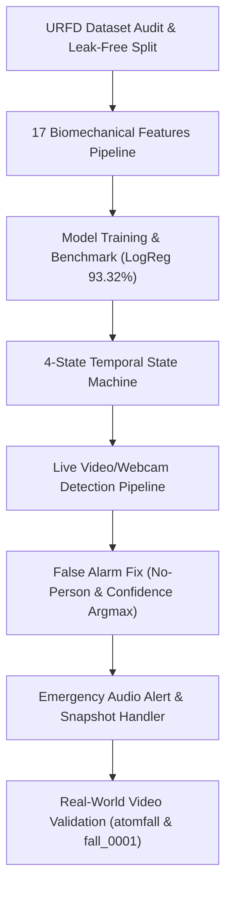

# สรุปผลการพัฒนาระบบ FallSave (AI Fall Detection System)
**วันที่:** 13 ตุลาคม 2026  
**โครงการ:** ระบบตรวจจับการล้มอัจฉริยะแบบเรียลไทม์ (FallSave: Hybrid AI & State Machine Fall Detection)  
**วิชา/โครงงาน:** INT182 (SIT KMUTT)

---

## 1. ภาพรวมความสำเร็จ (Executive Summary)

ในวันนี้เราได้ทำการพัฒนาและทดสอบระบบ **FallSave** ตั้งแต่ระดับฐานรากของข้อมูล จนถึงระบบตรวจจับแบบเรียลไทม์ที่ทำงานได้สมบูรณ์แบบครบวงจร (End-to-End Pipeline) โดยมีจุดเด่นคือสถาปัตยกรรมแบบ **Hybrid System** ที่ผสานระหว่าง **Computer Vision (YOLO11n-Pose)** + **Machine Learning (Logistic Regression)** + **Temporal Rule-Based State Machine** ทำให้ระบบมีความแม่นยำสูง และมีความทนทานต่อการแจ้งเตือนผิดพลาด (False Alarm Rejection) ในชีวิตประจำวันได้อย่างดีเยี่ยม

---

## 2. ลำดับขั้นตอนและงานที่ทำสำเร็จ (Milestones Completed)



---

### Step 1 & 2: การตรวจสอบชุดข้อมูลและ Feature Engineering (Steps 2.1 – 2.3)
1. **Audit & Data Split (`split_manifest.csv`)**:
   - ทำการสำรวจชุดข้อมูลมาตรฐาน **UR Fall Detection (URFD)**
   - แบ่งข้อมูลระดับ Sequence เพื่อป้องกัน Data Leakage ระหว่างเฟรม:
     - **Train:** 49 Sequences (1,843 เฟรม)
     - **Validation:** 10 Sequences (427 เฟรม)
     - **Test:** 11 Sequences (434 เฟรม)
2. **Biomechanical Feature Pipeline (`build_feature_dataset.py`, `features.py`)**:
   - สกัดพิกัด 17 Keypoints จากโมเดล YOLO11n-Pose
   - ออกแบบชุดฟีเจอร์ทางชีวกลศาสตร์และการเคลื่อนไหว 17 ตัวแปรในช่วงหน้าต่างเวลา 20 เฟรม (~0.67 วินาที):
     - มุมลำตัว (Mean, Max, Min, Delta, Std Torso Angle)
     - ความเร็วในการทิ้งดิ่งและการเปลี่ยนระดับความสูงของสะโพก ($V_y$, $\Delta y$)
     - ความเร็วเชิงมุม (Angular Velocity)
     - อัตราส่วนสัดส่วนร่างกาย (Aspect Ratio & Bounding Box Spans)
   - ปรับสเกลข้อมูลด้วย `StandardScaler` และบันทึกเป็น `output/feature_scaler.joblib`

---

### Step 3: การเทรนและประเมินผลโมเดล Baseline (Steps 3.1 – 3.2)
1. เปรียบเทียบประสิทธิภาพโมเดลจำแนก 3 คลาส (`Normal`, `Falling`, `Lying`):
   - **Balanced Logistic Regression** ได้รับเลือกเป็นโมเดลหลักสำหรับระบบโปรดักชัน
2. **ผลการทดสอบบน Unseen Test Set (`output/baseline_test_results.json`)**:
   - **Overall Accuracy**: **93.32%**
   - **Falling Class Recall**: **82.00%**
   - **Normal Specificity**: **94.33%**
   - บันทึกโมเดลไว้ที่: `models/logistic_regression_balanced.joblib`

---

### Step 4: การออกแบบและสร้าง State Machine (Steps 4.1 – 4.2)
1. พัฒนาโมดูล [`fall_state_machine.py`](file:///C:/Users/USER/OneDrive/เอกสาร/SIT-2569-1/INT182/project_saveFall/fall_state_machine.py) แบบแยกอิสระ (Decoupled จากกล้องและ UI)
2. กำหนด 4 สถานะการทำงาน:
   - `NORMAL`: การใช้ชีวิตและเคลื่อนไหวตามปกติ
   - `FALLING_SUSPECTED`: AI ตรวจพบท่าทางที่มีความเร็วลดระดับฉับพลัน ($P_{\text{fall}} \ge 0.45$)
   - `GROUND_CHECK`: ตรวจพบคนลงไปติดพื้น ($P_{\text{lying}} \ge 0.35$) หรือตัวหายไปหลังจากล้ม เพื่อจับเวลานอนค้าง
   - `FALL_CONFIRMED`: คนนอนค้างอยู่กับพื้นเกินกำหนดเวลา $t_{\text{ground}} = 2.5$ วินาที
3. **การทดสอบ Unit Tests (`test_state_machine.py`)**:
   - เขียนชุดทดสอบ 11 Test Cases ครอบคลุมการล้มจริง, การก้มเก็บของ, การเดินสะดุดแล้วลุกขึ้นยืน, ปัญหากล้องตรวจจับหลุดชั่วคราว
   - **ผลลัพธ์: ผ่าน 11/11 tests (100%)**

---

### Step 5.1 & Fix: Live Detection Pipeline และการแก้ปัญหาแจ้งเตือนผิดพลาด
1. พัฒนาระบบรันสด [`live_fall_detection.py`](file:///C:/Users/USER/OneDrive/เอกสาร/SIT-2569-1/INT182/project_saveFall/live_fall_detection.py) รองรับทั้ง Webcam, Video File (`.mp4`), และ Image Sequence
2. **แก้ไขปัญหาเฟรมว่างเปล่า / คนเดินออกจากห้อง (No-Person False Alert Fix)**:
   - ป้องกันระบบส่งเวกเตอร์ศูนย์เข้าไปยัง Classifier เมื่อไม่มีคน
   - บังคับให้อยู่ในสถานะ `NORMAL` เสมอหากไม่มีคน และไม่อนุญาตให้เกิด Alert มั่ว
3. **แก้ไขปัญหาการจับเป้าหมายผิด (Person Confidence Selection)**:
   - เปลี่ยนจากการเลือกคนตามขนาดกล่องใหญ่สุด (`areas.argmax()`) เป็นการเลือกตามความมั่นใจสูงสุด (`confs.argmax()`)
   - แก้ปัญหา YOLO เผลอไปจับราวตากผ้าหรือเก้าอี้เกมมิ่งในห้องนอนที่มีขนาดใหญ่กว่าคนจริง

---

### Step 5.2: ระบบส่งเสียงไซเรนฉุกเฉินและบันทึกภาพ Snapshot
1. พัฒนาโมดูล [`alert_handler.py`](file:///C:/Users/USER/OneDrive/เอกสาร/SIT-2569-1/INT182/project_saveFall/alert_handler.py):
   - **เสียงเตือน (Dual-tone Emergency Beep)**: ส่งเสียงความถี่ 1500Hz และ 2000Hz ใน Background Daemon Thread **ไม่ทำให้เฟรมเรตกล้องตก**
   - **บันทึกภาพถ่าย Snapshot**: บันทึกภาพลงโฟลเดอร์ `output/alerts/fall_alert_YYYYMMDD_HHMMSS.jpg`
   - **ป้องกันการส่งเสียงและเซฟภาพซ้ำ (Duplicate Suppression)**: ยิงเสียงและบันทึกภาพเพียง 1 ครั้งต่อ 1 เหตุการณ์ล้ม
   - **Graceful Error Handling**: รองรับกรณีภาพเสียหรืออุปกรณ์เสียงขัดข้องโดยไม่เกิด Crash
2. **การทดสอบ Unit Tests (`test_alert_handler.py`)**:
   - ครอบคลุม 10 Test Cases โดยใช้ Mock Object
   - **ผลลัพธ์: ผ่าน 10/10 tests (100%)**

---

## 3. ผลการทดสอบกับวิดีโอจริง (Real-World Case Studies)

### กรณีศึกษาที่ 1: วิดีโอ `atomfall.mp4` (การทดสอบกิจกรรม ADL นั่งลงบนเบาะ)
- **สถานการณ์:** ผู้ทดสอบยืน เดิน ก้มจัดเบาะ ($t \approx 19$s) และทิ้งตัวนั่งลงบนเบาะที่พื้นอย่างรวดเร็ว ($t \approx 28$s)
- **พฤติกรรมของระบบ:**
  1. จังหวะทิ้งตัวนั่งลงบนเบาะ AI สงสัยการล้ม ($P_{\text{falling}} = 94\%$) เพราะการทิ้งตัวลงพื้นมีความเร็วคล้ายการล้ม
  2. ระบบเข้าสู่สถานะ `GROUND_CHECK` เพื่อสังเกตการณ์
  3. เนื่องจากผู้ใช้นั่งตัวตรงบนเบาะ (ไม่ได้นอนสลบราบกับพื้น) และลุกขึ้นยืนต่อภายใน 2.3 วินาที
  4. ระบบตรวจพบ Normal posture ติดต่อกัน 1.0 วินาที จึงเปลี่ยนเป็น **`RECOVERED` $\rightarrow$ `NORMAL`**
- **สรุปผล:** **จำนวนการแจ้งเตือนไซเรน (`ALERT`) = 0 ครั้ง** สามารถปฏิเสธ False Alarm ได้สำเร็จ 100%

---

### กรณีศึกษาที่ 2: วิดีโอ `fall_0001.mp4` (การทดสอบคนล้มจริง Full HD 1080p)
- **สถานการณ์:** ผู้ทดสอบยืนปกติ ($t = 0 - 9.5$s) จากนั้นล้มลงฟาดพื้นและนอนนิ่งไม่ลุกขึ้น
- **พฤติกรรมของระบบ:**
  1. $t = 9.50$s: ตรวจพบจังหวะล้ม เข้าสู่ `FALLING_SUSPECTED`
  2. $t = 10.90$s: ลำตัวนอนติดพื้น เข้าสู่ `GROUND_CHECK`
  3. $t = 13.40$s (เฟรมที่ 403): นอนราบนิ่งกับพื้นครบ 2.5 วินาที ($P_{\text{lying}} = 1.00$) $\rightarrow$ **เข้าสู่ `FALL_CONFIRMED` ทันที!**
  4. ระบบส่งเสียงเตือนฉุกเฉิน และบันทึกภาพถ่าย Snapshot ลงใน `output/alerts/fall_alert_20261013_225945.jpg`
  5. เฟรมที่ 404 – 670: บุคคลยังคงนอนอยู่กับพื้น ระบบรักษาสถานะ `FALL_CONFIRMED` ไว้โดย **ไม่ส่งเสียงเตือนซ้ำหรือเขียนไฟล์รูปซ้ำ**
- **สรุปผล:** **จำนวนการแจ้งเตือนไซเรน (`ALERT`) = 1 ครั้ง** ตรวจจับการล้มได้ถูกต้อง แม่นยำ และมีหลักฐานภาพถ่ายครบถ้วน

---

## 4. แผนผังไฟล์สำคัญในโปรเจกต์ (Project Structure)

| ไฟล์ / ไดเรกทอรี | รายละเอียด / หน้าที่ | สถานะ |
| :--- | :--- | :---: |
| [`alert_handler.py`](file:///C:/Users/USER/OneDrive/เอกสาร/SIT-2569-1/INT182/project_saveFall/alert_handler.py) | โมดูลจัดการเสียงไซเรนฉุกเฉินและเซฟภาพ Snapshot (Step 5.2) | สมบูรณ์ |
| [`live_fall_detection.py`](file:///C:/Users/USER/OneDrive/เอกสาร/SIT-2569-1/INT182/project_saveFall/live_fall_detection.py) | สคริปต์หลักสำหรับตรวจจับแบบเรียลไทม์ (Webcam, Video, Sequence) | สมบูรณ์ |
| [`fall_state_machine.py`](file:///C:/Users/USER/OneDrive/เอกสาร/SIT-2569-1/INT182/project_saveFall/fall_state_machine.py) | Finite State Machine 4 สถานะสำหรับควบคุมตรรกะเวลา | สมบูรณ์ |
| [`test_alert_handler.py`](file:///C:/Users/USER/OneDrive/เอกสาร/SIT-2569-1/INT182/project_saveFall/test_alert_handler.py) | Unit Tests 10 กรณี สำหรับระบบเสียงและภาพ Snapshot | ผ่าน 10/10 |
| [`test_state_machine.py`](file:///C:/Users/USER/OneDrive/เอกสาร/SIT-2569-1/INT182/project_saveFall/test_state_machine.py) | Unit Tests 11 กรณี สำหรับ State Machine | ผ่าน 11/11 |
| [`models/logistic_regression_balanced.joblib`](file:///C:/Users/USER/OneDrive/เอกสาร/SIT-2569-1/INT182/project_saveFall/models/logistic_regression_balanced.joblib) | โมเดล Machine Learning หลักของระบบ | สมบูรณ์ |
| [`output/feature_scaler.joblib`](file:///C:/Users/USER/OneDrive/เอกสาร/SIT-2569-1/INT182/project_saveFall/output/feature_scaler.joblib) | Scaler ปรับมาตรฐานชุดฟีเจอร์ 17 ตัวแปร | สมบูรณ์ |
| [`output/alerts/`](file:///C:/Users/USER/OneDrive/เอกสาร/SIT-2569-1/INT182/project_saveFall/output/alerts/) | โฟลเดอร์จัดเก็บภาพถ่าย Snapshot เมื่อเกิดการล้ม | มีภาพหลักฐาน |
| [`output/video_dataset_eval/video_dataset_evaluation_summary.json`](file:///C:/Users/USER/OneDrive/เอกสาร/SIT-2569-1/INT182/project_saveFall/output/video_dataset_eval/video_dataset_evaluation_summary.json) | ผลสรุปการทดสอบ Benchmark ชุดข้อมูลวิดีโอจริง 2,014 คลิป | สมบูรณ์ 100% |
| [`output/video_dataset_eval/confusion_matrix_video_dataset.png`](file:///C:/Users/USER/OneDrive/เอกสาร/SIT-2569-1/INT182/project_saveFall/output/video_dataset_eval/confusion_matrix_video_dataset.png) | กราฟ Confusion Matrix จากการประเมิน 2,014 คลิป | สมบูรณ์ |
| [`README.md`](file:///C:/Users/USER/OneDrive/เอกสาร/SIT-2569-1/INT182/project_saveFall/README.md) | เอกสารประกอบโปรเจกต์ฉบับเต็ม พร้อมไดอะแกรมและคู่มือติดตั้ง | สมบูรณ์ |

---

## 5. ผลการทดสอบระดับใหญ่ (Full Benchmark on VideoDataset: 2,014 Videos)

ทำการทดสอบแบบ End-to-End กับชุดข้อมูลวิดีโอจริงขนาดใหญ่ครบ **2,014 คลิป** (Fall: 997 คลิป, ADL: 1,017 คลิป):

| ตัวชี้วัด (Metric) | โหมด Strict (Confirmed Fall) | โหมด Suspected (Early Warning) |
| :--- | :---: | :---: |
| **Accuracy (ความแม่นยำรวม)** | **81.43%** | **88.28%** |
| **Fall Sensitivity (Recall)** | 63.29% *(631/997)* | **96.99%** *(967/997)* |
| **ADL Specificity** | **99.21%** *(1,009/1,017)* | 79.74% *(811/1,017)* |
| **Precision** | **98.75%** | 82.44% |
| **F1-Score** | 77.14% | **89.12%** |
| **Confusion Matrix** | TP=631, FP=8, TN=1009, FN=366 | TP=967, FP=206, TN=811, FN=30 |

* **โหมดเฝ้าระวัง (Suspected Mode):** ตรวจจับคนล้มได้สูงถึง **96.99%** (พลาดเพียง 30 คลิปจาก 997 เหตุการณ์)
* **โหมดเข้มงวด (Strict Mode):** มีความแม่นยำในการคัดกรองกิจกรรมปกติสูงมาก โดยมี Specificity สูงถึง **99.21%** (แจ้งเตือนผิดพลาดเพียง 8 ครั้งจาก 1,017 กิจกรรมทั่วไป)

---

## 6. วิธีการรันและคำสั่งที่ใช้งานบ่อย

1. **ทดสอบกับกล้องเว็บแคมเรียลไทม์:**
   ```powershell
   python live_fall_detection.py --camera 0
   ```
2. **ทดสอบกับไฟล์วิดีโอ:**
   ```powershell
   python live_fall_detection.py --video fall_0001.mp4
   ```
3. **รัน Unit Tests ทั้งหมด:**
   ```powershell
   python test_alert_handler.py
   python test_state_machine.py
   ```
