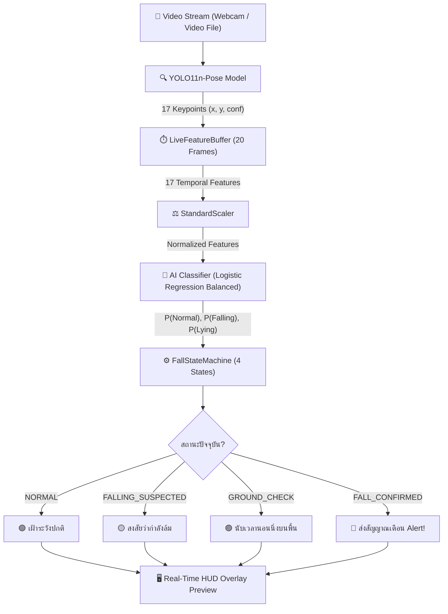
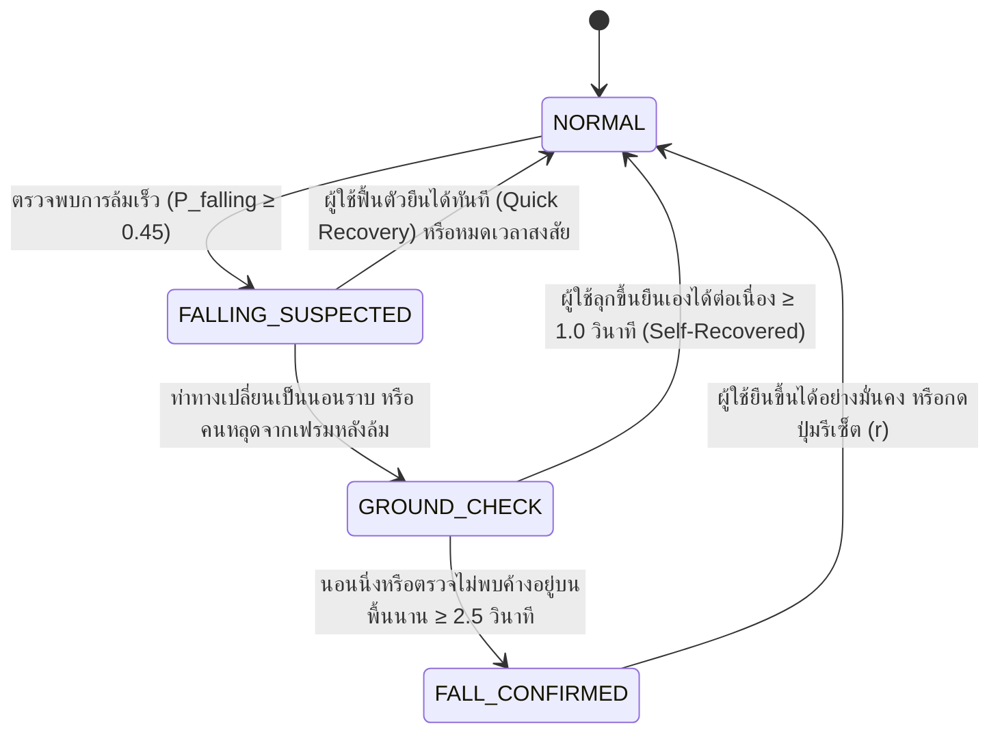

# 🛡️ FallSave: ระบบตรวจจับการล้มอัจฉริยะแบบ Hybrid AI

<p align="center">
  
  
  
  
  
</p>

---

## 📖 สารบัญ (Table of Contents)
- [บทนำ (Introduction)](#-บทนำ-introduction)
- [จุดเด่นของระบบ (Key Features)](#-จุดเด่นของระบบ-key-features)
- [สถาปัตยกรรมระบบ (System Architecture)](#-สถาปัตยกรรมระบบ-system-architecture)
- [การทำงานของ State Machine (Decision Logic)](#-การทำงานของ-state-machine-decision-logic)
- [ผลการทดสอบประสิทธิภาพ (Evaluation Benchmark)](#-ผลการทดสอบประสิทธิภาพ-evaluation-benchmark)
- [โครงสร้างโฟลเดอร์โปรเจกต์ (Project Structure)](#-โครงสร้างโฟลเดอร์โปรเจกต์-project-structure)
- [การติดตั้งและเตรียมสภาพแวดล้อม (Installation)](#-การติดตั้งและเตรียมสภาพแวดล้อม-installation)
- [คู่มือการใช้งานและการทดสอบ (Usage Guide)](#-คู่มือการใช้งานและการทดสอบ-usage-guide)
- [การรันชุดทดสอบ (Unit Testing)](#-การรันชุดทดสอบ-unit-testing)

---

## 🎯 บทนำ (Introduction)

**FallSave** เป็นระบบตรวจจับการหกล้มสำหรับผู้สูงอายุและผู้ป่วยแบบเรียลไทม์โดยใช้ **กล้องเว็บแคมเดี่ยว (Webcam-only)** โดยไม่ต้องพึ่งพาเซนเซอร์สวมใส่ (Wearable Sensors) หรืออุปกรณ์ฮาร์ดแวร์ภายนอก (Arduino / Accelerometer) 

ระบบใช้แนวคิดการออกแบบ **Hybrid Architecture (AI + Temporal State Machine + Confirmation Timer)** เพื่อแก้ปัญหาจุดอ่อนที่พบบ่อยในระบบตรวจจับการล้มแบบดั้งเดิม เช่น การส่งสัญญาณเตือนผิดพลาด (False Alarms) จากการก้มหรือนั่งลงเร็ว และปัญหาโมเดลตรวจจับหาคนไม่เจอเมื่อลงไปนอนราบบนพื้น

---

## 🌟 จุดเด่นของระบบ (Key Features)

- **Pure Vision-Based:** ใช้งานผ่านกล้องเว็บแคมธรรมดาได้ทันที ติดตั้งง่าย ไม่รบกวนความเป็นส่วนตัวในการสวมใส่อุปกรณ์
- **YOLO11n-Pose Keypoint Tracking:** ตรวจจับโครงสร้างร่างกาย 17 จุดแบบความเร็วสูง รองรับการทำงานแบบเรียลไทม์
- **Scale-Invariant Biomechanical Features:** วิเคราะห์คุณลักษณะทางชีวกลศาสตร์ 17 ตัวแปร (มุมเอียงของลำตัว, ความเร็วการดิ่งลงของสะโพก, อัตราส่วนกรอบร่างกาย) ที่ถูก Normalize ด้วยความยาวลำตัวจริงของผู้ใช้ ทำให้แม่นยำแม้ผู้ใช้อยู่ใกล้หรือไกลกล้อง
- **Temporal Sliding Window (20 Frames):** ประมวลผลพฤติกรรมการเคลื่อนไหวตามช่วงเวลาต่อเนื่อง (~0.67 วินาที) แทนการตัดสินจากภาพเฟรมเดี่ยว
- **Anti-False Alarm State Machine:** กรองการสะดุดชั่วคราว การก้มเก็บของ หรือการนั่งลงเก้าอี้ได้อย่างชาญฉลาด
- **Robust Floor Occlusion Recovery:** รองรับกรณีที่กล้องตรวจจับคีย์พอยต์หลุดเมื่อคนนอนราบกับพื้น ด้วยตัวจับเวลายืนยันความปลอดภัยอัตโนมัติ

---

## 🏗️ สถาปัตยกรรมระบบ (System Architecture)



---

## 🔄 การทำงานของ State Machine (Decision Logic)

State Machine ถูกออกแบบด้วยสถาปัตยกรรม 4 สถานะ เพื่อความปลอดภัยสูงสุด (Safety-First):



| สถานะ | เงื่อนไขการเข้าสู่สถานะ | พฤติกรรมของระบบ |
| :--- | :--- | :--- |
| **`NORMAL`** | สภาวะเริ่มต้น / กิจวัตรปกติ | เฝ้าระวังแบบปกติ ไม่มีเสียงเตือน |
| **`FALLING_SUSPECTED`** | $P_{\text{falling}} \ge 0.45$ | เริ่มจับเวลา หากเป็นเพียงการนั่งเร็วแล้วลุกขึ้น จะรีเซ็ตกลับ Normal ทันที |
| **`GROUND_CHECK`** | $P_{\text{lying}} \ge 0.35$ หรือ คนหายไปจากกล้องหลังล้ม | เริ่มนับเวลาถอยหลัง 2.5 วินาที เพื่อดูว่าคนลุกขึ้นยืนเองได้หรือไม่ |
| **`FALL_CONFIRMED`** | อยู่บนพื้นต่อเนื่องนาน $\ge 2.5$ วินาที | **ยืนยันการล้มสำเร็จ** ส่งสัญญาณ `ALERT_TRIGGERED` |

---

## 📊 ผลการทดสอบประสิทธิภาพ (Evaluation Benchmark)

ประเมินผลบนชุดข้อมูลมาตรฐาน **UR Fall Detection Dataset (URFD)** จำนวน 70 Sequences (11,936 เฟรม) โดยแบ่ง Train / Validation / Test ในระดับ Sequence แบบ 100% Data-Leakage Free:

### ประสิทธิภาพบน Test Set (614 Windows ที่ไม่เคยเห็นมาก่อน)

| เมทริกซ์ (Metrics) | คะแนนที่ได้ | ความหมายทางคลินิก/การใช้งานจริง |
| :--- | :---: | :--- |
| **Overall Accuracy** | **93.32%** | ความแม่นยำโดยรวมสูงในการจำแนกท่าทาง |
| **Falling Recall (Safety Critical)** | **82.00%** | **ตรวจจับจังหวะล้มจริงได้ 41 จาก 50 เหตุการณ์** (หลุดรอดน้อยมาก) |
| **Normal Specificity** | **94.33%** | กรองกิจกรรมในชีวิตประจำวันทั่วไปได้ถูกต้อง ไม่เตือนมั่ว |
| **Macro F1 (Observable Classes)** | **83.49%** | ค่าเฉลี่ยความสมดุลระหว่าง Precision และ Recall |

---

## 📁 โครงสร้างโฟลเดอร์โปรเจกต์ (Project Structure)

```text
project_saveFall/
│
├── dataset/                     # ข้อมูลภาพ URFD (fall 30 คลิป, normal 40 คลิป)
├── metadata/
│   └── split_manifest.csv       # รายชื่อ Sequence และการแบ่ง Train/Val/Test
├── models/
│   ├── logistic_regression_balanced.joblib   # โมเดล Baseline AI ที่ผ่านการเทรน
│   ├── random_forest_balanced_default.joblib
│   └── dummy_most_frequent.joblib
├── output/
│   ├── feature_scaler.joblib    # StandardScaler ที่ Fit จาก Training Set
│   ├── features_train.csv       # ฟีเจอร์ชุด Train (1,461 windows)
│   ├── features_validation.csv  # ฟีเจอร์ชุด Val (871 windows)
│   ├── features_test.csv        # ฟีเจอร์ชุด Test (878 windows)
│   └── baseline_test_report.md  # รายงานผลการประเมิน
│
├── fall_state_machine.py        # Core State Machine (4 States, Decoupled Logic)
├── test_state_machine.py        # Unit Tests ครอบคลุม 8 สถานการณ์จำลอง
├── live_fall_detection.py       # ระบบ Live Inference + Real-Time HUD Overlay
├── build_feature_dataset.py     # ไปป์ไลน์ดึงฟีเจอร์และสร้าง Sliding Windows
├── train_baseline_classifiers.py# สคริปต์เทรนและเปรียบเทียบโมเดล
├── evaluate_baseline_test.py    # สคริปต์ทดสอบ Test Set
├── yolo11n-pose.pt              # โมเดล YOLO11n-Pose Pretrained
└── README.md                    # เอกสารประกอบโปรเจกต์
```

---

## ⚙️ การติดตั้งและเตรียมสภาพแวดล้อม (Installation)

### 1. โคลนโปรเจกต์และสร้าง Virtual Environment
```powershell
# ไปที่โฟลเดอร์โปรเจกต์
cd project_saveFall

# สร้างและเปิดใช้งาน Virtual Environment
python -m venv venv
.\venv\Scripts\activate
```

### 2. ติดตั้ง Dependencies ที่จำเป็น
```powershell
pip install ultralytics opencv-python scikit-learn pandas numpy joblib
```

---

## 🚀 คู่มือการใช้งานและการทดสอบ (Usage Guide)

โปรแกรม [`live_fall_detection.py`](file:///C:/Users/USER/OneDrive/เอกสาร/SIT-2569-1/INT182/project_saveFall/live_fall_detection.py) รองรับการทดสอบ 3 โหมด:

### 1. เปิดกล้องเว็บแคมทดสอบสดแบบ Real-Time
```powershell
python live_fall_detection.py --camera 0
```
- ระบบจะเปิดกล้องเว็บแคม วาดโครงกระดูกมนุษย์ และแสดงแถบสถานะแบบสดๆ

### 2. ป้อนไฟล์วิดีโอเข้ามาทดสอบ (`.mp4`, `.avi`, `.mov`)
```powershell
python live_fall_detection.py --video "path/to/your_video.mp4"
```
- ระบบจะเล่นวิดีโอตามความเร็ว FPS จริงของไฟล์ พร้อมประมวลผลการล้มแบบเรียลไทม์

### 3. ทดสอบด้วยชุดข้อมูล Sequence ในโปรเจกต์ (ไม่ต้องมีกล้อง)
```powershell
# ทดสอบคลิปคนล้มจริง (fall-03):
python live_fall_detection.py --sequence dataset/fall/fall-03-cam0-rgb --hold-last-frame 3.0

# ทดสอบคลิปกิจกรรมปกติ นั่งเก้าอี้ (adl-01):
python live_fall_detection.py --sequence dataset/normal/adl-01-cam0-rgb
```

### 🎮 ปุ่มควบคุมบนหน้าต่าง Preview
- **`q`** : ปิดและออกจากโปรแกรม
- **`r`** : รีเซ็ตสถานะ State Machine กลับเป็น `NORMAL`

---

## 🧪 การรันชุดทดสอบ (Unit Testing)

ระบบมาพร้อมกับ Unit Tests 8 ชุด เพื่อรับประกันความถูกต้องของตรรกะการตัดสินใจในทุกสภาวะ:

```powershell
python -m unittest test_state_machine.py -v
```

**รายการเคสที่ผ่านการทดสอบ 100%:**
- `test_normal_activity_remains_in_normal` — กิจกรรมปกติไม่หลุดจาก Normal
- `test_isolated_falling_spike_does_not_alert` — สัญญาณล้มแหลมขึ้นมา 1 เฟรมไม่เกิด False Alarm
- `test_genuine_fall_with_lying_triggers_alert_once` — ล้มจริงและนอนนิ่ง ส่งสัญญาณเตือนเพียงครั้งเดียว
- `test_false_alarm_quick_recovery` — สะดุดแล้วลุกขึ้นได้เอง ระบบยกเลิกการเตือน
- `test_fall_followed_by_pose_detection_loss` — ล้มแล้วกล้องหาคนบนพื้นไม่เจอ ยังคงนับเวลาเตือนสำเร็จ
- `test_intermittent_missing_detections_during_ground_check` — คีย์พอยต์ติดๆ ดับๆ ตัวจับเวลาบนพื้นไม่สะดุด
- `test_timestamp_jitter_and_framerate_variation` — รองรับอัตราเฟรมเรตไม่คงที่
- `test_manual_reset` — ฟังก์ชันรีเซ็ตระบบทำงานถูกต้อง

---

## 👥 ผู้พัฒนาและการติดต่อ (Credits)
- **รายวิชา:** INT182 Data Structures & Algorithms / Project Work
- **สถาบัน:** คณะเทคโนโลยีสารสนเทศ (SIT), มหาวิทยาลัยเทคโนโลยีพระจอมเกล้าธนบุรี (KMUTT)
